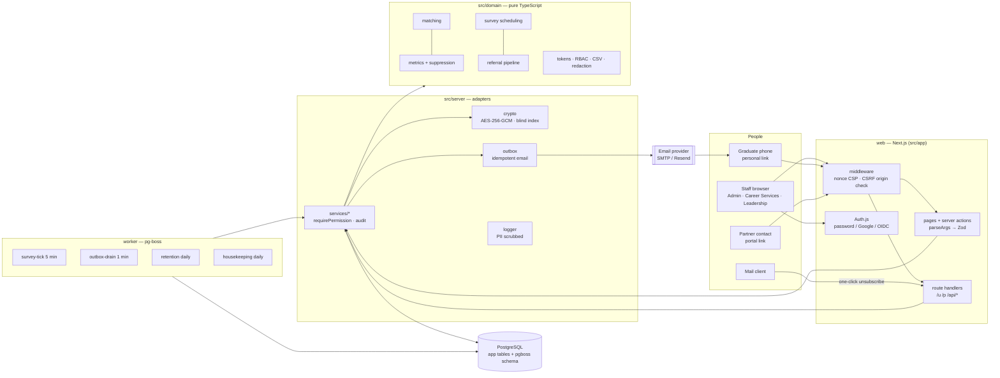

# Alumni Tracker

Tracks graduate career outcomes for the Academy:

- an up-to-date career record for every graduate
- automated check-in surveys at 1, 3, 6 and 12 months
- personal self-update links
- a placement board that matches graduates to partner openings
- an honest outcomes report

Graduates report their own status. **The system never scrapes LinkedIn or any other site.**

> **Status:** All five build phases are complete. See [Acceptance criteria](#acceptance-criteria) for the test that proves each requirement.

## Quick start

Requirements: Docker, and Node.js ≥ 20.18 for running tests and scripts on the host.

```bash
cp .env.example .env          # then fill the four secrets (see comments in the file)
for k in AUTH_SECRET BLIND_INDEX_KEY TOKEN_SIGNING_KEY; do
  sed -i.bak "s|^$k=.*|$k=$(openssl rand -base64 32)|" .env
done
sed -i.bak "s|^DATA_ENCRYPTION_KEYS=.*|DATA_ENCRYPTION_KEYS=v1:$(openssl rand -base64 32)|" .env && rm .env.bak

docker compose up -d --build          # Postgres (host port 5440), Mailpit, web (:3000), worker
docker compose exec web npm run db:seed
```

Open http://localhost:3000 and sign in with a seeded staff email and the dev password `alumni-dev-password` (set `SEED_STAFF_PASSWORD` before seeding to change it). Password-reset emails arrive in **Mailpit** at http://localhost:8025.

| Email | Role | Sees |
|---|---|---|
| `admin@academy.example` | Admin | Everything |
| `careers@academy.example` | Career Services | Graduate records, contact info (audited), openings, referrals |
| `marketing@academy.example` | Leadership / Marketing | Aggregated reports only |

### Running on the host instead of in Docker

```bash
npm ci
docker compose up -d db mailpit
npx prisma migrate deploy
npm run db:seed
npm run dev            # http://localhost:3000
```

## Scripts

| Command | What it does |
|---|---|
| `npm run dev` | Dev server: the custom server in `server.ts` wrapping Next.js in dev mode |
| `npm start` | Production server (after `npm run build`): `server.ts` wrapping Next.js; resolves the client IP from the socket (see Deploying) |
| `npm run worker` | Background job worker (pg-boss) |
| `npm run jobs:run -- <job>` | Run one job immediately (no argument lists the jobs) |
| `npm run user:set-password -- <email>` | Set a staff password from the server (prints a generated one, or uses `STAFF_PASSWORD`). Add `--create ADMIN "Full Name"` to create the first admin in a new deployment |
| `npm run db:migrate` | Apply committed migrations |
| `npm run db:seed` | Seed realistic fake data. Refuses to run on a non-empty database. |
| `npm run db:reset` | Drop, re-migrate and re-seed the **dev** database |
| `npm test` | Unit and integration tests. Integration tests use `TEST_DATABASE_URL`, which must end in `_test`. |
| `npm run test:coverage` | Unit tests with domain coverage (threshold 80%) |
| `npm run test:e2e` | Playwright end-to-end tests (builds must exist: `npm run build`) |
| `npm run test:e2e:tls` | HTTPS suite: production build behind Caddy (`docker compose --profile tls`), asserting real `Set-Cookie` flags. Needs Docker. |
| `npm run test:e2e -- --project=mobile` | Graduate flows on a Pixel 7 profile, including the slow-phone performance budget |
| `npm run check:no-scraping` | Fails if scraping libraries, non-allowlisted outbound HTTP or `linkedin.com` access appear in app code |

## Background jobs

Jobs run in the `worker` process on **pg-boss**, a durable queue stored in the same Postgres; there are no in-memory timers.
- `docker compose up` starts one worker. You can run more for redundancy: each cron tick runs once, on one worker.
- Every job is idempotent, so a missed or repeated tick never sends duplicates.

| Job | Schedule (UTC) | What it does |
|---|---|---|
| `survey-tick` | every 5 min | Queues due milestone surveys (or skips them after a recent self-update), queues reminders (+4 and +10 days, maximum 2), then sends |
| `outbox-drain` | every minute | Sends due emails, retries transient failures with backoff, recovers sends interrupted by a crash (see [D34](docs/DECISIONS.md)) |
| `retention` | daily 02:43 | Anonymizes graduates past the retention period (default 5 years after graduation) and deletes old audit and email logs |
| `housekeeping` | daily 03:17 | Deletes expired one-time codes, rate-limit counters and staff sign-in tokens |

Run any job by hand: `npm run jobs:run -- survey-tick`. Failed emails appear under **Surveys → Failed emails**, where staff can retry or dismiss them.

## How staff sign in

- **No sign-up.** An admin adds each staff member under **Admin → Staff users**; the new user gets an email with a link (72 hours, single use) to choose a password.
- **Everyone** can sign in with email + password, and lands on the main page (dashboard, or reports for Leadership).
- **Non-admin staff** can also use **Continue with Google** (or OIDC SSO), matched by email. Google must report the email as verified, and the account must already exist and be active.
- **Admins** can sign in only with email + password; Google/SSO is refused for them.
- **Forgot password** emails a reset link (1 hour, single use, never reveals whether the email is registered). Setting a password signs the user out everywhere.
- **Limits:** 10 attempts per account and 20 per IP every 15 minutes. Passwords need at least 12 characters and are hashed with scrypt.
- **Google setup:** create an OAuth client (Web application) in Google Cloud Console with the redirect URI `$APP_URL/api/auth/callback/google`, then set `GOOGLE_CLIENT_ID` and `GOOGLE_CLIENT_SECRET`. The button appears only when both are set.

## How graduates use it

- **No account.** Every survey email contains a fresh personal link (`/u/<token>`, valid 30 days). Opening it starts a 2-hour session on `/me`.
- **On `/me` a graduate can:**
  - update their status (one tap for "nothing changed")
  - edit job-search preferences and skills
  - change each consent separately (effective immediately)
  - change their email (needs a 6-digit code sent to the current address)
  - stop or restart check-in emails
- **If a link has expired or was revoked,** they get a "send me a new link" page. It never reveals whether an email is registered.
- **Staff can** revoke all of a graduate's links, or email them a fresh one, from the graduate page.

## Placement in one paragraph

Career Services creates openings, or partners submit them through their portal link into a review queue. Each opening lists ranked candidates with a 0–100 score and a plain-language explanation, for example: "Matches 4 of 5 required skills; missing: Docker. Remote OK." Staff click **Notify**, and the graduate gets an email with **I'm interested / Not interested**.
After *Interested*, plus the graduate's `share_with_partners` consent, the referral can move to *Referred*; only then does the partner see the candidate's details. The rule is enforced on the server and re-checked on every read. Moving a card to *Hired* records the job automatically and asks staff to confirm it.

## Architecture



- **`src/domain`**: framework-independent business logic, unit tested. Lint forbids it from importing Next.js or Prisma.
- **`src/server`**: adapters.
  - Prisma, encryption, the email adapters (console / SMTP / Resend), Auth.js, the rate limiter and the logger (with personal-data redaction).
  - `services/` holds every use case. Each one checks permissions and writes to the audit log.
- **`src/app`**: the UI. Server actions are thin wrappers around services.

More detail: [docs/DECISIONS.md](docs/DECISIONS.md).

## Privacy and security in brief

Full details: [docs/PRIVACY.md](docs/PRIVACY.md) (written for graduates, also shown at `/privacy`) and [docs/DECISIONS.md](docs/DECISIONS.md).

- **Least data.**
  - Salary is stored only as bands.
  - There are no columns for age, gender, nationality or photos.
  - LinkedIn URLs are plain text that is never fetched; CI fails on scraping code (`check:no-scraping`).
- **Encryption and audit.**
  - Email, phone and LinkedIn URL are encrypted with AES-256-GCM using versioned keys, plus HMAC blind indexes for lookups.
  - Contact details stay hidden until a staff member chooses to view them; every view and every export is audited.
  - Audit diffs never contain contact values.
- **Server-side authorization.**
  - Every service function checks the actor's permission itself.
  - A test sweeps every service function as a Marketing user and expects a refusal.
  - Partners see a graduate only after **Interested** + `share_with_partners` consent, re-checked on every read.
- **Consent** is per purpose, versioned, and revocable from the graduate's page with immediate effect.
- **Graduate rights.**
  - Download my data and delete my account, both behind a one-time code.
  - Deletion anonymizes: personal data is removed, anonymous history is kept, so reports don't change (tested).
  - Retention: a daily job anonymizes graduates 5 years after graduation (configurable) and prunes old logs.
- **Web hardening.**
  - Strict per-request nonce CSP: no inline scripts.
  - HSTS, `frame-ancestors 'none'`, `nosniff` and `no-referrer`.
  - HTTP-only, SameSite cookies; server-action origin checks.
  - Zod validation at every boundary; Prisma parameterized queries only.
  - Rate limits on every token, code and sign-in endpoint.
  - Application logs scrub personal data.
- **Dependencies.**
  - `npm audit --omit=dev` reports 0 vulnerabilities.
  - nodemailer is pinned to 10.x through `overrides`; the advisories in earlier versions are fixed only in 10.x.

## Deploying

- **Run behind TLS.** Set `APP_URL=https://…`; cookies then become `Secure` and the CSP adds `upgrade-insecure-requests`. `APP_URL` also pins the URL used in sign-in emails, which are never built from request headers. To try HTTPS locally, run `docker compose --profile tls up tls`; Caddy serves https://localhost:8443.
- **Start with `npm start`, not `next start`.** The custom server in `server.ts` is what makes client IPs trustworthy. Started any other way, rate-limited endpoints refuse every request, because no trusted client IP reaches the app; this is a deliberate safe failure.
- **Client IP (`TRUSTED_PROXY_HOPS`, `CLIENT_IP_HEADER`).** Rate limits and lockouts are keyed by the client IP, so it must not be spoofable.
  - **No proxy:** leave `TRUSTED_PROXY_HOPS=0` (default). `X-Forwarded-For` is ignored and the socket address is used.
  - **Behind N reverse proxies** that each append to `X-Forwarded-For`: set `TRUSTED_PROXY_HOPS=N`. The app must then be reachable **only** through those proxies (firewall it), or clients can spoof their address.
  - **Behind a CDN** that sets its own header (e.g. `cf-connecting-ip`) and overwrites it on every request: set `CLIENT_IP_HEADER` to that name instead.
  - **No usable IP:** such requests are refused on rate-limited endpoints; they never share an "unknown" bucket.
  - **The bundled `docker compose` setup:** Docker's port forwarding makes every client appear as the Docker gateway. Fine for local use, but put a proxy in front for real deployments.
- **Shared networks.** Graduates on one campus or mobile network can share an IP address, so many bad links from that network can briefly lock all of them out. The limits are adjustable under **Settings → Lockout after repeated failures**, with safe minimums.
- **Keep links out of proxy logs.** Personal links contain tokens, so configure your reverse proxy **not to log the paths** `/u/*`, `/p/*` and `/unsubscribe/*`.
- **Proxies that rewrite the Host header** need `experimental.serverActions.allowedOrigins` set in `next.config.ts`.
- **Rotating the encryption key:** prepend a new key, e.g. `DATA_ENCRYPTION_KEYS=v2:<new>,v1:<old>`. New writes use v2 and old data stays readable.
- **Do not rotate `BLIND_INDEX_KEY`** without re-indexing emails.
- **Email:** use `EMAIL_PROVIDER=resend` (idempotent sends) where possible. With SMTP, a send interrupted by a crash is marked *uncertain* and never resent automatically.
- **First admin:** after `prisma migrate deploy`, run `npm run user:set-password -- you@example.org --create ADMIN "Your Name"` and sign in with the printed password.
- **Workers:** run at least one `worker`. Several are safe, since pg-boss runs each cron tick once.

## Acceptance criteria

| Criterion | Proven by |
|---|---|
| Setting a cohort's graduation date schedules exactly 4 surveys per graduate; changing it reschedules with no duplicates | `tests/integration/scheduling.test.ts` |
| A graduate can update their status from a phone in under 60 s using only the emailed link | `tests/e2e/graduate-flows.spec.ts` (desktop + Pixel 7); `graduate-performance.spec.ts` (usable in ~1.4 s on slow 4G with 4× CPU throttling) |
| An expired or rotated link is rejected and offers a new-link request | `tests/e2e/graduate-flows.spec.ts`, `tests/integration/self-service.test.ts` |
| For any opening, matched candidates are ranked and each match has a readable explanation | `src/domain/matching/match.test.ts`, `tests/integration/placement.test.ts`, `tests/e2e/placement.spec.ts` |
| A graduate's details never reach a partner without both the Interested click and `share_with_partners` consent | `tests/integration/placement.test.ts` ("sharing with partners (acceptance)"), `tests/e2e/placement.spec.ts` |
| A Marketing user cannot see any individual's name or email anywhere | `tests/integration/rbac.test.ts` (every service function), `tests/e2e/permissions.spec.ts`, `tests/e2e/reports.spec.ts` |
| The outcomes report shows employment rate with response rate and unknowns, median time to first job and top employers, and suppresses groups smaller than 5 | `src/domain/metrics/metrics.test.ts`, `tests/integration/reports.test.ts`, `tests/e2e/reports.spec.ts` |
| Moving a referral to `hired` produces an employment record and updates the report | `tests/integration/placement.test.ts`, `tests/integration/reports.test.ts`, `tests/e2e/placement.spec.ts` |
| Deleting a graduate removes their personal data while aggregate numbers stay unchanged | `tests/integration/privacy.test.ts` ("ACCEPTANCE: deleting a graduate…") |
| Nothing in the codebase fetches or scrapes LinkedIn or any third-party profile | `npm run check:no-scraping` (in CI) |
| Accessibility: WCAG 2.2 AA (automated), keyboard, chart table views | `tests/e2e/a11y-security.spec.ts` (axe on every main page, light and dark) |

## Documentation

- [docs/DECISIONS.md](docs/DECISIONS.md): every judgement call, numbered
- [docs/METRICS.md](docs/METRICS.md): exact metric definitions and privacy rules
- [docs/PRIVACY.md](docs/PRIVACY.md): the privacy notice for graduates
- [docs/API.md](docs/API.md) and [docs/openapi.yaml](docs/openapi.yaml): HTTP endpoints and server actions

## Roadmap

1. ✅ **Foundation**
   - Schema and migrations, staff auth (invite-only, email + password; Google/SSO for non-admins), roles, audit log
   - Encryption, graduate records (list, filters, stale view, detail, create/edit), employment timeline
   - CSV import with dry run, company normalisation and merge queue
   - Seed data, CI
2. ✅ **Surveys**
   - Scheduler, outbox with idempotent email, signed personal links
   - Survey and self-update forms, one-time codes, reminders, quiet hours, dead-letter view, response rates
3. ✅ **Placement**
   - Openings with a review queue, a synonym-aware matching engine with explanations, "You might be a fit" emails with Interested / Not interested
   - Referral board and table with metrics, hire → employment record, partner portal with the sharing check
4. **Reporting**: metrics, outcomes dashboard, charts, exports, small-group suppression
5. ✅ **Hardening**
   - Data export and deletion with one-time codes, retention job, admin settings
   - Nonce CSP and dependency fixes, axe accessibility pass (light and dark), slow-phone performance budget
   - PRIVACY, API and OpenAPI docs
